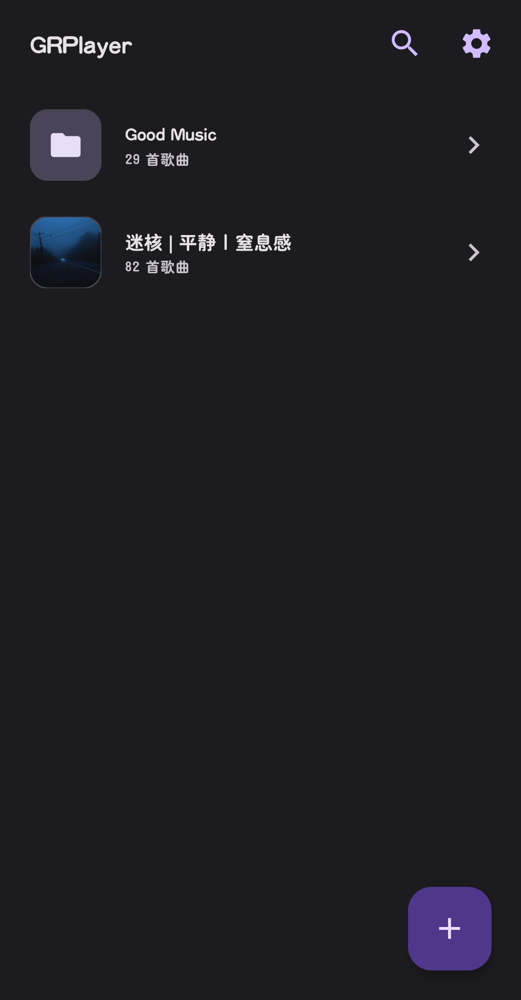
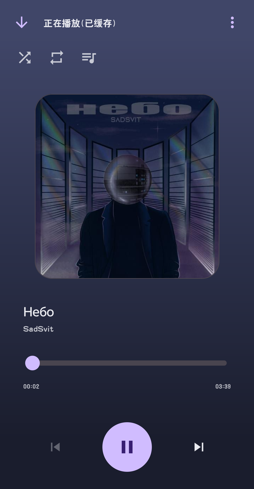
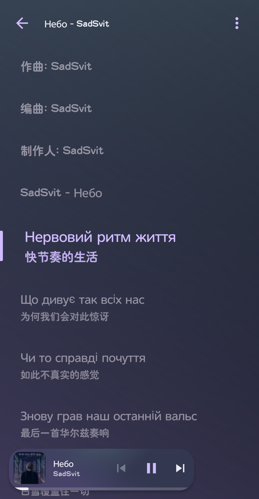
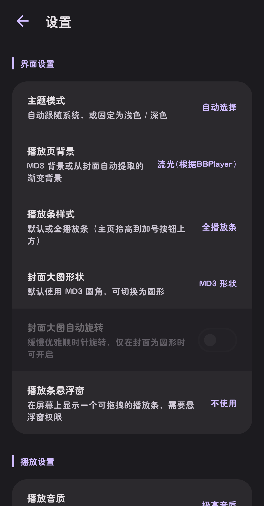

# grplayer-app
<div align="center">

<h1>GRPlayer</h1>

一款使用 Java 构建的 Android 原生的网易云音乐的第三方音乐播放器。更轻量、更顺手的搜索、后台播放、收藏夹、缓存导出与歌词体验。


</div>

---

## 屏幕截图

| 首页 | 播放器 | 歌词页 | 设置 |
| :--: | :--: | :--: | :--: |
|  |  |  |  |

## 主要功能

### 核心播放体验

- **搜索**：支持单曲、歌手、专辑、歌单搜索。
- **后台播放**：基于 Media3 `MediaSessionService`，支持通知栏控制与后台稳定播放。
- **迷你播放条**：自动注入到各页面底部，快速切歌、暂停与进入播放页。
- **播放控制**：播放/暂停、上一首、下一首、进度拖拽、顺序播放、随机播放、循环模式。
- **定时关闭**：支持自定义分钟数，到点自动暂停播放。
- **播放页**：大封面、歌曲信息、进度条、加载指示器，支持进入歌词页。

### 收藏与歌单

- **本地收藏夹**：新建收藏夹，收藏歌曲到多个文件夹。
- **整专辑 / 歌手 / 歌单收藏**：一键拉取全部歌曲并保存为本地收藏夹。
- **拖拽排序**：支持收藏夹排序与收藏夹内歌曲排序。
- **JSON 歌单导入导出**：导出收藏夹为 JSON 配置，也可从 JSON 文件导入为新收藏夹。

### 缓存与导出

- **缓存到软件**：支持缓存歌曲并在本地离线播放。
- **缓存管理**：显示缓存进度，支持取消缓存、删除缓存。
- **导出到本地**：导出到 `/Music/GRPlayer/`，自动识别 `.mp3`、`.flac`、`.m4a`、`.mp4` 等扩展名。
- **进度弹窗**：缓存 / 导出均带进度与取消操作。

### 歌词系统

- **LRC 解析**：支持 `[mm:ss.xxx]`、`[mm:ss:xxx]`、`[mm:ss]` 等时间戳。
- **翻译歌词**：自动合并翻译歌词，支持“原文 + 翻译”或“仅翻译”。
- **实时高亮**：播放进度同步高亮当前行，平滑滚动。
- **点击跳转**：点击任意歌词行可跳转到对应时间。
- **歌词设置**：字号、对齐方式、翻译显示模式均可配置。

### 音质与网络

- **多档音质**：标准、极高、无损、Hi-Res、高清环绕、沉浸环绕、杜比全景声、臻音全景声、超清母带。
- **沉浸声子类型**：`c51`、`ste`、`aac`。
- **音质兜底策略**：逐个后退、自动兼容、从最差向上、不回退固定。
- **音质学习**：根据播放结果学习可用音质，减少无效请求。
- **网络重试**：可设置重试次数与重试间隔。
- **伪装请求 IP**：默认关闭，可随机生成请求 IP，降低按 IP 限流影响，只用于防止限流目的，并做出一系列守护机制。
- **限流识别**：自动识别接口限流并给出提示。

### 界面与体验

- **Material 3**：基于 `Theme.Material3.DayNight.NoActionBar`。
- **深色模式**：支持跟随系统、浅色、深色。
- **播放页背景**：支持 MD3 背景与封面渐变背景。
- **系统栏适配**：渐变模式下状态栏、导航栏颜色跟随封面。
- **电池优化引导**：引导加入电池优化白名单，提升后台播放稳定性。
- **全局点击防抖**：减少误触与重复点击。

## 技术栈

- **语言**：Java
- **UI**：AndroidX、Material Components for Android、RecyclerView、ConstraintLayout
- **播放**：AndroidX Media3 ExoPlayer、MediaSessionService
- **网络**：OkHttp、自定义 JSON API Client
- **图片**：自定义 ImageLoader + LruCache
- **存储**：SharedPreferences、内部缓存目录、SAF 文件选择器
- **异步**：ExecutorService、Handler、HandlerThread
- **歌词**：自定义 LrcParser
- **构建**：Gradle

## 项目结构

```text
app/src/main/java/com/gascy/grplayer/
├── MainActivity.java
├── SearchActivity.java
├── SearchDetailActivity.java
├── ArtistDetailActivity.java
├── PlaylistDetailActivity.java
├── FolderDetailActivity.java
├── PlayerActivity.java
├── LyricActivity.java
├── SettingsActivity.java
├── BaseActivity.java
├── adapter/
├── data/
├── model/
├── net/
├── playback/
├── ui/
└── util/
```

资源目录：

```text
app/src/main/res/
├── layout/
├── drawable/
├── anim/
└── values/
```

## 构建与运行

1. 使用 Android Studio 打开项目。
2. 等待 Gradle 同步完成。
3. 连接 Android 设备或启动模拟器。
4. 运行应用。
5. 首次启动时按需授予通知、存储 / 所有文件访问等权限。

## 配置说明

- 默认 API 地址位于 `ApiClient.BASE_URL`。
- 如需使用自部署服务，修改该地址即可。
- “伪装请求 IP”默认关闭，请根据实际使用场景与相关服务条款谨慎开启，只用于防止限流目的，并做出一系列守护机制。
- 音质、兜底策略、重试次数、歌词、主题等均可在设置页调整。

## 隐私与数据

- 收藏夹、设置、缓存等数据默认保存在本地。
- 本项目自身不包含用户画像、广告或主动上传个人数据的逻辑。
- 网络请求会发送至所配置的 API 服务，请自行确认并是否使用。

## 致谢

感谢以下开源项目与生态：

- AndroidX
- Material Components for Android
- OkHttp
- AndroidX Media3
- AndroidIDE
- 以及所有为 Android 开源社区做出贡献的开发者

同时也感谢 [BBPlayer](https://github.com/bbplayer-app/BBPlayer) 同类音乐播放器项目带来的设计灵感。

## 开源许可

本项目采用 MIT 许可。详见 [LICENSE](./LICENSE)。
