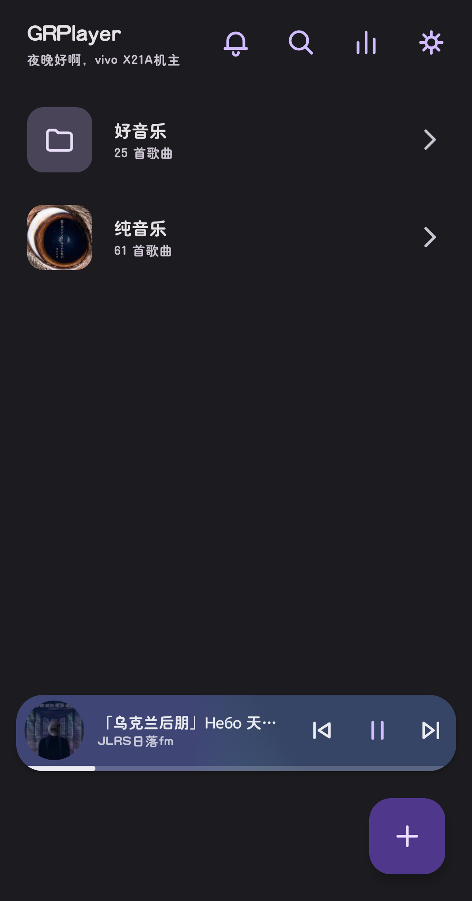
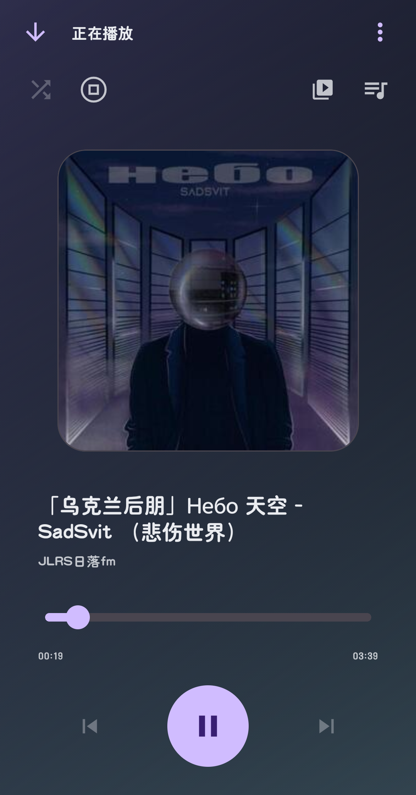
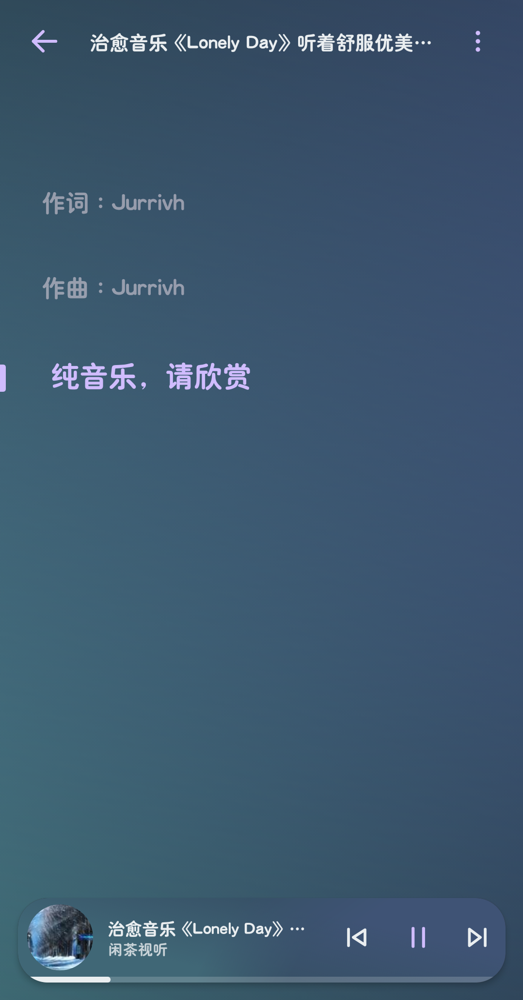
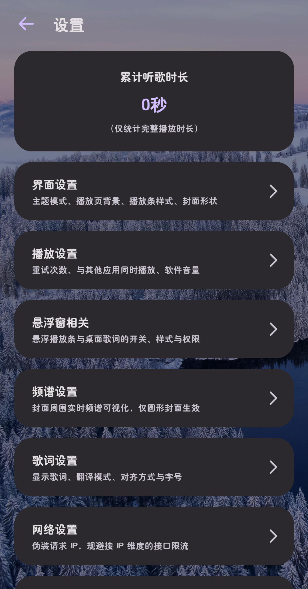

# grplayer-app

<div align="center">

<h1>GRPlayer</h1>

一款使用 Java 构建的 Android 原生 B 站第三方音频播放器。更轻量简约、更炫酷沉浸、更顺手的搜索、收藏夹、缓存导出与歌词体验。


</div>

---

## 项目简介

GRPlayer 是一款使用 Java 构建的 Android 原生 B 站第三方音频播放器，基于 Media3 实现后台播放，围绕 B 站视频音频提供搜索、链接识别、播放、收藏、缓存、导出、歌词、频谱、均衡器与悬浮窗等能力。

---

## 重大变更（V4.0.0）

从 V4.0.0 开始，GRPlayer 正式从「网易云 + B 站混合播放器」调整为**纯粹的 B 站音频播放器**，后续将保持这一方向。

> 如果你此前收藏过网易云音乐歌曲，这些歌曲在 V4.0.0 及之后版本中将无法播放。建议使用收藏夹详情页三点菜单中的「清除失效内容」整理收藏夹。

---

## 屏幕截图

| 首页 | 播放器 | 歌词页 | 设置页 |
| :--: | :--: | :--: | :--: |
|  |  |  |  |

---

## 功能特性

### 1. 搜索、链接识别与历史

- **B 站关键词搜索**：搜索 B 站视频音频，展示标题、UP 主、封面与时长。
- **B 站视频链接 / ID 识别**：支持粘贴 B 站视频链接、BV 号、AV 号、b23.tv 短链，自动识别视频并跳转到结果页；识别或解析失败时自动回退为关键词搜索。
- **B 站合集 / 系列链接识别**：支持识别 `space.bilibili.com/<mid>/lists/<id>` 合集链接与 `?type=series` 系列链接，直接跳转合集 / 系列远程列表页。
- **系统分享接收**：可从其他应用分享文本到 GRPlayer，自动识别其中的 B 站视频 / 合集 / 系列链接；失败时按原文关键词搜索。
- **搜索模式**：在搜索结果页长按顶栏可进入搜索模式，隐藏标题并显示搜索框，自动带入当前关键词；修改后点击搜索或软键盘搜索键即可重新搜索，并记入搜索历史。
- **B 站分区限制**：可在「设置 → 平台管理」中切换「仅音乐区（默认）」与「不限制（所有分区）」。关键词搜索会按当前设置过滤分区；用户主动粘贴 BV/AV/b23/合集/系列链接的识别不受该设置影响。
- **搜索历史**：保存最近 300 条记录，包含关键词、搜索类型与搜索时间；单曲搜索首屏结果可本地缓存；点击历史可回搜；支持单条删除与清空历史，并同步清理对应结果缓存。

### 2. 播放、队列与音质

- **后台播放**：基于 Media3 `MediaSessionService`，支持通知栏控制与后台稳定播放。
- **播放控制**：播放/暂停、上一首、下一首、进度拖拽、顺序播放、随机播放、循环模式、单曲循环等。
- **播放队列**：播放页可打开队列面板，查看当前队列、快速切歌，并可将非当前歌曲临时移出本次队列，不影响收藏夹。
- **单曲播放模式**：搜索结果单曲点击时按单曲播放，避免误把整个搜索结果作为播放列表；合集 / 远程列表等页面点击条目时以当前列表作为播放队列。
- **定时关闭**：支持自定义分钟数，到点自动暂停播放。
- **软件音量**：独立于系统音量，单独调节本应用的播放音量，不影响其它应用。
- **播放速度**：支持 `0.10x ~ 3.00x` 倍速，采用变速同时变调的「磁带式」处理，尽量保证即时生效与流畅体验。
- **B 站音质选择**：支持 `64K / 132K / 192K` 三档音质，播放、缓存、导出统一遵循该设置。
- **B 站音质兜底策略**：支持「固定音质」「从最高音质开始逐个向下」「从最低音质开始逐个向上」；当选择 64K 时，兜底行显示为固定音质并禁用，切回更高音质后恢复此前选择。
- **播放页**：大封面、歌曲信息、进度条、加载指示器，支持进入歌词页；支持锁定模式、播放页背景、封面形状与旋转。
- **标题自适应字号**：播放页长按歌曲标题可切换自适应字号，设置全局持久化。
- **歌曲详情**：可查看歌曲名称、UP 主、视频 ID、时长、播放来源、缓存文件大小、播放链接与封面链接，并支持复制。
- **悬浮重试消息**：加载失败时在屏幕右上角弹出悬浮窗，展示封面与歌名，支持手动重试或 5 秒倒计时自动重试；可在「设置 → 播放设置 → 重试」中开启，需悬浮窗权限。

### 3. 合集、系列与分 P

- **视频合集 / 独立分 P 列表页**：从播放页可进入当前 B 站视频所在合集；若视频不在合集内但为多 P 视频，则展示独立分 P 列表。
- **合集分页加载**：视频合集列表支持分页加载，并支持收藏整个合集为本地收藏夹。
- **分 P 展开**：独立多 P 视频支持展开 / 收起分 P 列表；分 P 元数据会写入磁盘缓存，默认 30 天 TTL，App 启动时异步清理过期缓存。
- **自动定位当前播放分 P**：从播放页进入合集 / 分 P 页时，可自动滚动并高亮当前正在播放的分 P。
- **B 站合集 / 系列远程列表页**：从搜索或分享的合集 / 系列链接进入，支持分页加载、滚动加载更多、收藏整个合集 / 系列，以及跳转 B 站网页查看。
- **搜索结果页不再内联展开分 P**：分 P、合集、系列统一由专门的合集 / 分 P / 远程列表页面处理，搜索结果页保持简洁。

### 4. 收藏与歌单

- **本地收藏夹**：支持新建收藏夹，收藏歌曲到多个文件夹。
- **整视频合集 / 系列收藏**：一键拉取合集或系列全部视频，并保存为本地收藏夹。
- **拖拽排序**：支持收藏夹排序与收藏夹内歌曲排序。
- **JSON 歌单导入导出**：导出收藏夹为 JSON 配置，也可从 JSON 文件导入为新收藏夹。
- **类型还原**：JSON 导入时，若配置中包含 `type` 与 `sourceId`，可还原收藏夹类型与来源 ID。
- **清除失效内容**：收藏夹详情页可清除旧版网易云音频；支持仅清除内容，或清除内容并复制失效歌名。

### 5. 缓存与导出

- **缓存到软件**：支持缓存 B 站音频并在本地离线播放；缓存音质遵循「设置 → 平台管理」中的 B 站音质与兜底策略。
- **缓存管理**：显示缓存进度，支持取消缓存、删除缓存。
- **导出到本地**：导出到 `/Music/GRPlayer/`，自动识别 `.mp3`、`.flac`、`.m4a`、`.mp4` 等扩展名；导出音质同样遵循 B 站音质与兜底策略。
- **进度弹窗**：缓存 / 导出均带进度与取消操作。
- **导出限制**：每日最多导出 20 个文件；成功导出后进入 60 秒冷却。
- **存储权限引导**：适配 Android 11+ 所有文件访问权限与旧版存储权限。

### 6. 歌词与桌面歌词

- **LRC 解析**：支持 `[mm:ss.xxx]`、`[mm:ss:xxx]`、`[mm:ss]` 等时间戳。
- **YRC 逐字歌词**：同时解析 YRC，并与 LRC 择优使用，避免只显示元数据。
- **翻译歌词**：自动合并翻译歌词，支持「原文 + 翻译」「仅翻译」「仅原文」。
- **实时高亮**：播放进度同步高亮当前行，平滑滚动。
- **点击跳转**：点击任意歌词行可跳转到对应时间。
- **歌词设置**：字号、对齐方式、翻译显示模式均可配置。
- **搜索歌词**：在歌词页内搜索网易云歌曲并替换当前歌词；依赖网易云官方接口直连。
- **导出歌词**：支持导出 LRC 歌词文件。
- **自动匹配**：当歌曲标题来自视频类音频时，可自动提取歌名、搜索网易云候选并打分匹配，匹配成功后缓存歌词。
- **桌面歌词**：支持浅色、深色、根据封面渐变、优雅的发光四种悬浮歌词样式。
- **优雅的发光**：支持描边色 / 歌词色自定义、发光与光照范围、描边粗细、抖动、逐字颤抖、逐字歌词，以及淡入淡出（含总开关与「从下方淡入 / 从上方淡出」）；支持开启「根据封面渐变」，开启后描边色、歌词色与光晕色跟随当前歌曲封面动态取色，关闭后使用手动颜色。

### 7. 频谱与均衡器

- **实时频谱**：通过 Media3 音频处理器采集 PCM 数据，使用 FFT 计算频谱。
- **三种频谱样式**：柱式、环式、块式。
- **频谱颜色**：支持 MD3 默认色与根据封面渐变取色。
- **显示条件**：仅在播放页、且封面大图为圆形时显示。
- **动画平滑**：带触发阈值、峰值衰减与冷却，避免频谱抖动。
- **15 段图形均衡器**：基于 `DynamicsProcessing`，需 Android 9 及以上。
- **均衡器预设**：平坦、开发者自用、开发者自用 2、自定义（上次保存），并支持自定义增益。
- **精调增益**：每段支持滑块与 +/- 步进按钮。
- **播放控件锁定**：进入均衡器页时暂停并锁定播放控件，退出后恢复。

### 8. 界面、悬浮窗与交互

- **Material 3**：基于 `Theme.Material3.DayNight.NoActionBar`。
- **深色模式**：支持跟随系统、浅色、深色。
- **播放页背景**：支持 MD3 背景、封面渐变背景、流光背景（根据 BBPlayer 设计灵感）。
- **底部播放条**：自动注入到各页面底部，快速切歌、暂停与进入播放页；支持默认 / 全播放条样式。
- **底部播放条背景**：支持 MD3 背景、封面渐变、流光，且与播放页背景完全独立设置。
- **悬浮播放条**：支持在系统上层显示可拖拽的播放条，需悬浮窗权限；支持默认播放条与全播放条。
- **悬浮窗前后台显示**：悬浮播放条与桌面歌词会随 App 前后台自动显示 / 隐藏，避免遮挡应用内界面。
- **系统栏适配**：渐变与流光模式下状态栏、导航栏颜色与图标跟随背景。
- **封面形状**：支持 MD3 圆角与圆形；圆形时可开启缓慢旋转。
- **电池优化引导**：引导关闭省电优化，提升后台播放稳定性。
- **全局点击防抖**：减少误触与重复点击，并优化滑动后首次点击体验。
- **免责声明**：首次启动展示免责声明，按钮带 20 秒倒计时确认。
- **悬浮窗权限校验**：启动与恢复时校验悬浮窗权限，避免 UI 状态与实际不一致。
- **自动检查更新**：启动后从 GitHub Releases 检查新版本，更新日志支持 Markdown 渲染；可跳转下载或「忽略此版本」。
- **近期调整计划**：主页顶栏消息按钮进入公告页，未读时显示红点；点击后标记已读。
- **捐赠入口**：设置页提供捐赠入口，捐赠页直接展示二维码。

---

## 技术栈

- **语言**：Java
- **UI**：AndroidX、Material Components for Android、RecyclerView、ConstraintLayout、TabLayout、Material 3
- **播放**：AndroidX Media3 ExoPlayer、MediaSessionService、Media3 OkHttp DataSource、SimpleCache、DefaultLoadControl
- **音频处理**：Media3 BaseAudioProcessor、SonicAudioProcessor、FFT、DynamicsProcessing（Android 9+）、AudioTrack PlaybackParams
- **网络**：OkHttp、B 站 API Client、WBI 签名与密钥缓存、B 站合集 / 系列 API、网易云官方歌词 / 搜索直连接口、GitHub Releases
- **图片**：自定义 ImageLoader + LruCache + 磁盘缓存，适配 B 站封面 `@w_h` 缩略语法与防盗链 Referer
- **存储**：SharedPreferences、内部缓存目录、SAF 文件选择器
- **异步**：ExecutorService、Handler、HandlerThread、Choreographer
- **歌词**：自定义 LrcParser，支持 LRC / YRC / 翻译合并
- **Markdown**：Markwon（更新日志）
- **构建**：Gradle、Android Gradle Plugin 8.0.0

---

## 项目结构

```text
app/src/main/java/com/gascy/grplayer/
├── MainActivity.java
├── SearchActivity.java
├── SearchDetailActivity.java
├── SeasonListActivity.java
├── BiliRemoteListActivity.java
├── FolderDetailActivity.java
├── PlayerActivity.java
├── LyricActivity.java
├── SettingsActivity.java
├── SettingsAppearanceActivity.java
├── SettingsPlaybackActivity.java
├── SettingsFloatingActivity.java
├── SettingsLyricActivity.java
├── SettingsNetworkActivity.java
├── SettingsPlatformActivity.java
├── SettingsSpectrumActivity.java
├── HistoryActivity.java
├── EqualizerActivity.java
├── DonationActivity.java
├── AnnouncementActivity.java
├── ShareReceiverActivity.java
├── BaseActivity.java
├── adapter/
├── data/
├── model/
├── net/
├── playback/
├── ui/
└── util/
```

资源目录：

```text
app/src/main/res/
├── layout/
├── drawable/
├── anim/
└── values/
```

核心模块说明：

- `net/`：B 站 API Client、WBI 签名、IP 伪装拦截器、B 站链接识别与解析（视频 / BV / AV / b23 / 合集 / 系列）、网易云官方歌词 / 搜索直连、GitHub 更新检查。
- `playback/`：PlayerManager、PlaybackService、频谱音频处理器。
- `ui/`：MiniPlayer、悬浮播放条、桌面歌词、悬浮重试消息、流光背景、频谱 View、发光文字 View。
- `data/`：收藏库、缓存、导出、歌词缓存、搜索历史、均衡器、设置、分 P 元数据缓存。
- `util/`：歌词解析、封面渐变、流光取色、歌词匹配、JSON 歌单、导出弹窗、分 P 展开辅助等。

---

## 构建与运行

1. 使用 Android Studio 打开项目。
2. 等待 Gradle 同步完成。
3. 连接 Android 设备或启动模拟器。
4. 运行应用。
5. 首次启动时按需授予通知、存储 / 所有文件访问、悬浮窗等权限。
6. 均衡器功能需要 Android 9 及以上系统。
7. 频谱功能需要在播放页将封面大图形状切换为圆形后开启。
8. 悬浮重试消息需要在设置中开启，并授予悬浮窗权限。
9. 项目当前配置：`compileSdk 33`、`minSdk 23`、`targetSdk 33`、Java 11，versionName `4.2.0`。发布构建需自行配置签名信息。

---

## 配置说明

- B 站 API 基地址位于 `BiliApiClient.BASE`；如需调整请修改该常量。
- 网易云官方歌词 / 搜索直连接口位于 `NeteaseDirectLyricClient`，仅用于 B 站歌词匹配与歌词搜索。
- “伪装请求 IP”默认关闭，可随机生成请求 IP，降低按 IP 限流影响，仅用于防止限流目的，并做出一系列守护机制。请根据实际使用场景与相关服务条款谨慎开启。
- B 站分区限制可在「设置 → 平台管理」中切换；关键词搜索会按当前设置过滤分区，粘贴 BV/AV/b23/合集/系列链接的识别不受影响。
- 网易云音质、网易云兜底策略等相关设置已随 V4.0.0 纯 B 站化移除；B 站音质选择与音质兜底策略位于「设置 → 平台管理」。
- 软件音量独立于系统音量，可在「设置 → 播放设置 → 音量」中单独调节。
- 悬浮重试消息可在「设置 → 播放设置 → 重试」中开启，并需授予悬浮窗权限。
- 频谱仅圆形封面生效；频谱样式与颜色可在「设置 → 频谱设置」中调整。
- 底部播放条背景可在「设置 → 界面设置」中独立配置，与播放页背景互不影响。
- 播放速度可在播放页右上角菜单的「倍速」中设置，支持 `0.10x ~ 3.00x`。
- 分 P 元数据磁盘缓存默认 30 天 TTL，App 启动时会异步清理过期缓存。
- 自动检查更新使用 GitHub Releases，可在弹窗中选择跳转下载或忽略该版本。
- 旧版网易云收藏可通过收藏夹详情页三点菜单中的「清除失效内容」清理。

---

## 隐私与数据

- 收藏夹、设置、缓存、搜索历史、歌词缓存、封面缓存等数据默认保存在本地。
- 本项目自身不包含用户画像、广告或主动上传个人数据的逻辑。
- 网络请求会发送至 B 站公开 API、网易云官方歌词 / 搜索接口（仅歌词能力）以及 GitHub Releases 更新接口，请自行确认是否使用。
- 伪装 IP 仅用于降低按 IP 维度限流影响，默认关闭，请遵守相关服务条款与法律法规。
- 自动检查更新仅请求 GitHub Releases 接口，不会上传本地数据。
- 更新日志与捐赠页的 Markdown 渲染均在本地完成。

---

## 版本历史

- 版本更新记录请查看 [Releases](https://github.com/Gascy37/grplayer-app/releases)。

---

## 致谢

感谢以下开源项目与生态：

- AndroidX
- Material Components for Android
- OkHttp
- AndroidX Media3
- Markwon
- AndroidIDE
- 以及所有为 Android 开源社区做出贡献的开发者

同时也感谢 [BBPlayer](https://github.com/bbplayer-app/BBPlayer) 同类音乐播放器项目带来的设计灵感。

---

## 捐赠

谢谢捐赠我可以喝可乐啦😋

<div align="center">
  
</div>

---

## 开源许可

本项目采用 MIT 许可。详见 [LICENSE](./LICENSE)。
